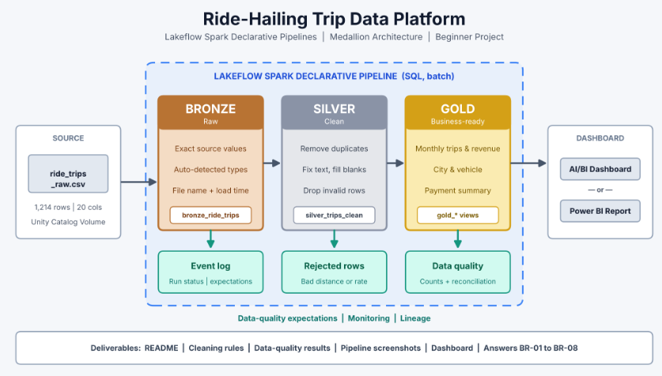
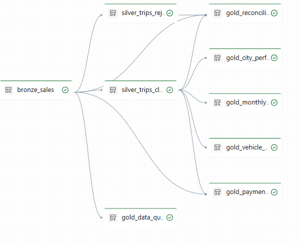
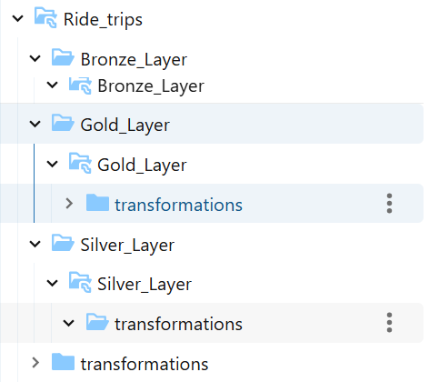
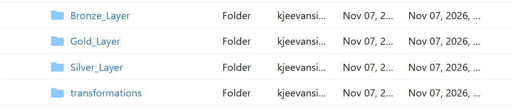

# Ride-Hailing Trips Analytics | Medallion Architecture

An end-to-end **ride-hailing trips data engineering project** that transforms raw trip records into clean, analytics-ready datasets using the **Medallion Architecture (Bronze → Silver → Gold)** in **Databricks Lakeflow Spark Declarative Pipelines (SQL)**.

The pipeline ingests trip data, applies data-quality checks and standardization, derives revenue metrics, and publishes business-focused Gold views for operational and financial analysis.



---

## Table of Contents

- [Business Problem](#business-problem)
- [Project Objectives](#project-objectives)
- [Architecture](#architecture)
- [Technology Stack](#technology-stack)
- [Dataset](#dataset)
- [Repository Structure](#repository-structure)
- [Medallion Layers](#medallion-layers)
- [Gold Analytics Views](#gold-analytics-views)
- [Data Quality and Reconciliation](#data-quality-and-reconciliation)
- [How to Run](#how-to-run)
- [Key Business Questions](#key-business-questions)
- [Documentation and Resources](#documentation-and-resources)
- [Future Enhancements](#future-enhancements)

## Business Problem

Ride-hailing platforms generate trip-level data across customers, drivers, locations, vehicles, booking channels, fares, discounts, and payments. Raw operational data can contain duplicate trips, missing values, inconsistent text, and invalid numeric values.

These issues can make business reporting unreliable. This project demonstrates a repeatable data pipeline that retains raw records, cleans and validates trip data, and produces curated datasets for analysis.

## Project Objectives

- Ingest raw ride-hailing trip data into a Bronze layer.
- Preserve source records and add ingestion metadata for traceability.
- Clean and standardize trip attributes in the Silver layer.
- identify invalid records and retain rejection reasons for review.
- Calculate net revenue and platform earnings.
- Build Gold-level aggregates for monthly, city, vehicle, payment, and data-quality analysis.
- Reconcile source records against clean, rejected, and duplicate records.

## Architecture

The project follows the Medallion Architecture:

```text
Raw CSV files
    |
    v
BRONZE LAYER
Raw ingestion + source metadata
    |
    v
SILVER LAYER
Deduplication + standardization + validation
    |                         |
    v                         v
Clean trip records       Rejected records
    |
    v
GOLD LAYER
Business aggregates + data quality + reconciliation
    |
    v
Analytics / BI reporting
```

### Architecture Diagram


### Pipeline Workflow



### Workspace Structure





## Technology Stack

| Technology | Usage |
|---|---|
| Azure Databricks | Data engineering and pipeline environment |
| Lakeflow Spark Declarative Pipelines | Declarative SQL pipeline processing |
| Apache Spark SQL | Data ingestion, transformation, and aggregation |
| Delta Lake | Managed table storage used by Databricks |
| CSV | Source trip dataset |
| Git and GitHub | Version control and project documentation |

## Dataset

- **File:** `data/ride_trips_raw.csv`
- **Format:** CSV
- **Purpose:** Raw trip-level data for the ride-hailing analytics pipeline.
- **Ingestion location configured in SQL:** `/Volumes/ride_hailing_trips/default/trips_data`

The Bronze pipeline reads CSV files from the configured Databricks Volume. Upload or place the source file in that Volume and ensure the pipeline has permission to read it.

The SQL transformations use fields including trip, customer and driver identifiers; trip date and pickup hour; city, region and pickup zone; booking channel; vehicle and trip types; distance, rate, fare, discount and driver payout; payment method/status; trip duration; and customer rating.

## Repository Structure

```text
Ride_Hailing_Trips/
│
├── Bronze_Layer/
│   └── Bronze_transformation.sql
│
├── Silver_Layer/
│   └── Silver_transformation.sql
│
├── Gold_Layer/
│   └── Gold_transformation.sql
│
├── data/
│   └── ride_trips_raw.csv
│
├── Images/
│   ├── Architecture.png
│   ├── Ride_Sales_Pipeline.png
│   ├── work_structure.png
│   └── work_top_level.png
│
├── docs/
│   └── Ride_Hailing_Trips_medaillian_case_study.pdf
│
└── README.md
```

## Medallion Layers

### 1. Bronze Layer — Raw Ingestion

**Script:** [Bronze_transformation.sql](Bronze_Layer/Bronze_transformation.sql)

Creates or refreshes the streaming table:

`ride_hailing_trips.default.bronze_sales`

Key operations:

- Reads CSV data using `read_files()` from the configured Unity Catalog Volume.
- Uses streaming ingestion.
- Preserves the source columns.
- Adds `file_path` using file metadata.
- Adds `ingested_at` using `current_timestamp()`.
- Defines expectations that `trip_id`, `customer_id`, and `driver_id` are not null.

**Purpose:** maintain a traceable raw layer that acts as the source for downstream transformations.

### 2. Silver Layer — Cleaning and Validation

**Script:** [Silver_transformation.sql](Silver_Layer/Silver_transformation.sql)

Creates or refreshes two materialized views:

| View | Purpose |
|---|---|
| `silver_trips_clean` | Distinct, standardized and valid trip records |
| `silver_trips_rejected` | Records failing the defined distance, rate, or payout checks, with a rejection reason |

Key operations:

- Removes duplicate output rows using `SELECT DISTINCT`.
- Trims and standardizes text fields with `TRIM()` and `INITCAP()`.
- Replaces selected missing descriptive values with `Unknown`.
- Derives fare when `fare_amount` is null using `distance_km * rate_per_km`.
- Calculates `net_revenue` as fare less discount.
- Calculates `platform_earnings` as fare less discount and driver payout.
- Applies expectations to distance, rate per kilometre, and driver payout.
- Creates a rejected-record view with a `reject_reason`.

**Purpose:** provide consistent, validated trip records while making rejected records available for investigation.

### 3. Gold Layer — Business-Ready Analytics

**Script:** [Gold_transformation.sql](Gold_Layer/Gold_transformation.sql)

Creates the following materialized views:

| Gold view | Business purpose |
|---|---|
| `gold_monthly_trips` | Monthly trip volume, kilometres, revenue, driver payout and platform earnings |
| `gold_city_performance` | Trip volume, net revenue and average fare by region and city |
| `gold_vehicle_performance` | Trip volume, kilometres, revenue and average customer rating by vehicle type |
| `gold_payment_analysis` | Trip volume, revenue and pending payment amount by payment method |
| `gold_data_quality` | Counts of duplicates, invalid values and missing fields in Bronze |
| `gold_reconciliation` | Counts of Bronze, clean, rejected and duplicate records, plus a reconciliation indicator |

**Purpose:** make curated metrics available for dashboards, reporting, and business decision-making.

## Gold Analytics Views

### Monthly Trip Trends
Analyze how trip volume, total distance, net revenue, driver payouts, and platform earnings change over time.

### City and Region Performance
Compare cities and regions based on trip count, total net revenue, and average fare per trip.

### Vehicle Performance
Understand which vehicle types contribute to trip volume, distance, revenue, and customer ratings.

### Payment Analysis
Review revenue by payment method and identify the amount associated with payments marked as `Pending`.

### Data Quality Monitoring
Monitor duplicate trip IDs, invalid distance/rate/payout values, and missing payment, fare, rating, or city fields.

## Data Quality and Reconciliation

The project applies the following checks in its current SQL implementation:

| Check | Current treatment |
|---|---|
| Missing trip/customer/driver IDs | Bronze expectations require these identifiers |
| Duplicate rows | Silver uses `SELECT DISTINCT`; Gold reports duplicate trip IDs |
| Distance | Null or non-positive values are rejected from the clean view |
| Rate per km | Null or negative values are rejected from the clean view |
| Driver payout | Null or negative values are rejected from the clean view |
| Descriptive text | Selected null values become `Unknown`; text is trimmed and title-cased |
| Missing fare | Fare is derived from distance multiplied by rate when possible |
| Revenue metrics | Net revenue and platform earnings are calculated in Silver |

See [Data Quality Rules](docs/data_quality_rules.md) and [Reconciliation](docs/reconciliation.md) for the detailed rules and interpretation.

> **Important:** the reconciliation view is a diagnostic summary. Its current formula compares Bronze rows with clean rows, rejected rows, and the count of duplicate trip IDs. Because the clean and rejected views have their own filtering and distinctness behavior, verify the counts against the actual dataset before treating the Boolean result as a complete row-level accounting proof.

## How to Run

1. **Prepare the source data.** Upload `ride_trips_raw.csv` to the Databricks Unity Catalog Volume configured as `/Volumes/ride_hailing_trips/default/trips_data`.
2. **Check the environment.** Confirm that the catalog `ride_hailing_trips`, schema `default`, Volume, and required permissions exist.
3. **Open the repository.** Clone or connect this GitHub repository to your Databricks workspace.
4. **Create the pipeline.** Create a Lakeflow Spark Declarative Pipeline and add the SQL files from the Bronze, Silver, and Gold folders.
5. **Run in dependency order.** Process Bronze first, then Silver, and finally Gold so that each downstream object can read its upstream tables/views.
6. **Validate the results.** Inspect the clean and rejected Silver views, then query the Gold views to confirm the metrics.
7. **Review reconciliation.** Check `gold_data_quality` and `gold_reconciliation` and investigate unexpected counts.

The SQL scripts currently target `ride_hailing_trips.default`. Update the catalog, schema, or Volume path in the scripts if your Databricks environment uses different names.

## Key Business Questions

This project supports questions such as:

- How does the number of trips and net revenue change month over month?
- Which cities and regions generate the highest trip volume and revenue?
- Which vehicle types cover the most distance and generate the most revenue?
- What is the average customer rating for each vehicle type?
- Which payment methods have the largest pending payment amount?
- How many raw records contain duplicates or invalid values?
- How many records are accepted into the clean layer versus identified as rejected?

## Documentation and Resources

- [Project Case Study (PDF)](docs/Ride_Hailing_Trips_medaillian_case_study.pdf)
- [Bronze SQL](Bronze_Layer/Bronze_transformation.sql)
- [Silver SQL](Silver_Layer/Silver_transformation.sql)
- [Gold SQL](Gold_Layer/Gold_transformation.sql)
- [Architecture Diagram](Images/Architecture.png)
- [Pipeline Diagram](Images/Ride_Sales_Pipeline.png)

## Future Enhancements

- Add automated validation queries and test cases for each layer.
- Strengthen reconciliation with a clearly defined record grain and mutually exclusive record categories.
- Add explicit handling and monitoring for null or invalid trip dates, ratings, discounts, and payment statuses.
- Add incremental file-arrival monitoring and pipeline failure alerts.
- Build a Databricks SQL or Power BI dashboard on top of the Gold views.
- Parameterize catalog, schema, and Volume locations for easier deployment across environments.

---

## Author

**Jeevan Kanumalaputi**

- GitHub: [Jeevan0510](https://github.com/Jeevan0510)
- Project: [Ride_Hailing_Trips](https://github.com/Jeevan0510/Ride_Hailing_Trips)
